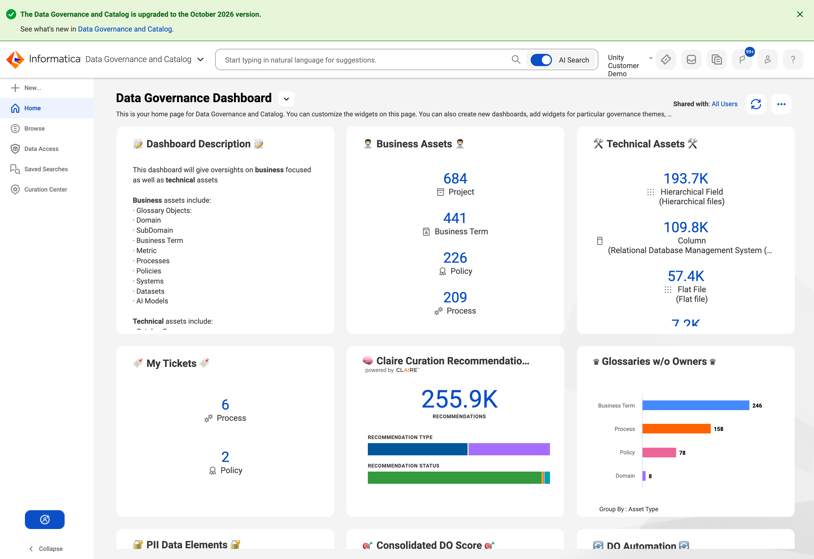

# CDGC Dashboards Marketplace

A catalog of ready-to-deploy **Informatica CDGC dashboards** — browse by use case, industry, source system or requirement, then import into your own CDGC org. Built for humans to *shop* and for AI agents to *learn from and propose* dashboards.

> 🔎 **Also here:** a classified catalog of **180 reusable CDGC saved searches** — tagged by use case, scope, asset type and source system — in [`SAVED_SEARCHES.md`](SAVED_SEARCHES.md) / [`saved-searches/`](saved-searches/) (machine index under `saved_searches` in [`catalog.json`](catalog.json)). A dashboard Search widget can point at any of them.

> **✅ Tested CDGC release:** `IDMC-202610-10M` — the dashboard export/import format is release-specific. Every dashboard here has been deployed and verified on this release (see each file's `tested_releases` and [`releases.json`](releases.json)). Importing into a **different** release may need adjustment — the import tool warns you when the target pod's release isn't in a dashboard's tested list. New releases are re-tested before being added.

## How to use

**People:** pick a dashboard, grab its JSON under [`dashboards/`](dashboards/), and deploy it with the [`cdgc-dashboard-export-import`](https://github.com/fboulbellout/claude-cdgc-skills) skill: `python3 cdgc_dashboard.py import --select "<name>" --apply`.

**Agents:** read [`catalog.json`](catalog.json) — every dashboard with `use_case`, `industry`, `source_systems`, `requirements`, `cdgc_release`, widget/saved-search counts and a description. Filter on any axis, then deploy or use as a design reference. Format in [`SCHEMA.md`](SCHEMA.md).

Each dashboard has a **screenshot preview** (real render from the CDGC UI) linked in the 🖼 column.

## Catalog (18 dashboards)

### 🤖 AI Governance

| Dashboard | 🖼 | Widgets | Source systems | Requirements | Notes |
|---|---|---|---|---|---|
| [AI Governance](dashboards/ai-governance/ai-governance.json) | [preview](dashboards/ai-governance/ai-governance.png) | 24 | Databricks, Flat files, RDBMS | AI inventory, model risk, AI oversight |  |
| [AI Inventories](dashboards/ai-governance/ai-inventories.json) | [preview](dashboards/ai-governance/ai-inventories.png) | 14 · 2 saved-search | — | AI system inventory, EU AI Act |  |
| [AI Governance - Risk View](dashboards/ai-governance/ai-governance-risk-view.json) | [preview](dashboards/ai-governance/ai-governance-risk-view.png) | 11 · 2 saved-search | — | AI risk classification, high-risk models | uses reusable saved searches |
| [AI Compliance - AICO Dashboard v2](dashboards/ai-governance/ai-compliance-aico-dashboard-v2.json) | [preview](dashboards/ai-governance/ai-compliance-aico-dashboard-v2.png) | 11 · 1 saved-search | — | AI compliance, regulatory |  |

### 🏠 Data Governance Home

| Dashboard | 🖼 | Widgets | Source systems | Requirements | Notes |
|---|---|---|---|---|---|
| [Data Governance Dashboard](dashboards/data-governance-home/data-governance-dashboard.json) | [preview](dashboards/data-governance-home/data-governance-dashboard.png) | 15 | Databricks, Flat files, Hierarchical/XML, IICS, Power BI, RDBMS | home page, business + technical assets, DQ overview |  |

### 🎯 Data Quality & Observability

| Dashboard | 🖼 | Widgets | Source systems | Requirements | Notes |
|---|---|---|---|---|---|
| [Data Quality and Observability](dashboards/data-quality/data-quality-and-observability.json) | [preview](dashboards/data-quality/data-quality-and-observability.png) | 23 · 1 saved-search | Flat files, RDBMS | DQ scoring, data observability |  |
| [Data Quality & Governance Dashboard](dashboards/data-quality/data-quality-governance-dashboard.json) | [preview](dashboards/data-quality/data-quality-governance-dashboard.png) | 18 | Flat files, IICS, RDBMS, Tableau | DQ + governance, rules & results |  |
| [Global Data Quality and Observability](dashboards/data-quality/global-data-quality-and-observability.json) | [preview](dashboards/data-quality/global-data-quality-and-observability.png) | 16 | Flat files, Hierarchical/XML, IICS, RDBMS | enterprise DQ, observability |  |
| [Observation et Qualité de données - FR](dashboards/data-quality/observation-et-qualit-de-donn-es-fr.json) | [preview](dashboards/data-quality/observation-et-qualit-de-donn-es-fr.png) | 13 | Flat files, Hierarchical/XML, IICS, RDBMS | DQ & observability (French) | 🌐 fr |
| [ERP Modernization - DQ Dashboard](dashboards/data-quality/erp-modernization-dq-dashboard.json) | [preview](dashboards/data-quality/erp-modernization-dq-dashboard.png) | 11 · 2 saved-search | Flat files, RDBMS | ERP migration DQ, reconciliation |  |

### 🧹 Governance & Curation

| Dashboard | 🖼 | Widgets | Source systems | Requirements | Notes |
|---|---|---|---|---|---|
| [Metadata Health & Curation](dashboards/governance-curation/metadata-health-curation.json) | [preview](dashboards/governance-curation/metadata-health-curation.png) | 16 · 1 saved-search | Databricks, Flat files, Hierarchical/XML, IICS, Power BI, RDBMS, Tableau | metadata health, curation backlog |  |
| [Curation Dashboard - 2](dashboards/governance-curation/curation-dashboard-2.json) | [preview](dashboards/governance-curation/curation-dashboard-2.png) | 14 | Databricks, Flat files, Hierarchical/XML, Power BI, RDBMS, Tableau | CLAIRE curation, classification review |  |
| [CLAIRE - Governance@Scale](dashboards/governance-curation/claire-governance-scale.json) | [preview](dashboards/governance-curation/claire-governance-scale.png) | 8 | Flat files, RDBMS | AI-assisted governance, recommendations |  |
| [Unstructured Data Governance](dashboards/governance-curation/unstructured-data-governance.json) | [preview](dashboards/governance-curation/unstructured-data-governance.png) | 8 · 5 saved-search | — | unstructured data, document governance | uses reusable saved searches |

### 🔐 Privacy & Compliance

| Dashboard | 🖼 | Widgets | Source systems | Requirements | Notes |
|---|---|---|---|---|---|
| [Data Privacy @DPO](dashboards/privacy-compliance/data-privacy-dpo.json) | [preview](dashboards/privacy-compliance/data-privacy-dpo.png) | 9 | Flat files, Hierarchical/XML, RDBMS | privacy, DPO view, personal data |  |
| [GDPR Regulation](dashboards/privacy-compliance/gdpr-regulation.json) | [preview](dashboards/privacy-compliance/gdpr-regulation.png) | 7 · 1 saved-search | — | GDPR, regulation coverage |  |

### 📈 Adoption & KPIs

| Dashboard | 🖼 | Widgets | Source systems | Requirements | Notes |
|---|---|---|---|---|---|
| [User Adoption](dashboards/adoption-kpi/user-adoption.json) | [preview](dashboards/adoption-kpi/user-adoption.png) | 8 | Flat files, Hierarchical/XML, Power BI, RDBMS, Tableau | adoption metrics, usage |  |

### 🧪 Line of Business

| Dashboard | 🖼 | Widgets | Source systems | Requirements | Notes |
|---|---|---|---|---|---|
| [Data Scientists - Sales LOB Dashboard v2](dashboards/line-of-business/data-scientists-sales-lob-dashboard-v2.json) | [preview](dashboards/line-of-business/data-scientists-sales-lob-dashboard-v2.png) | 10 | Databricks, Power BI | data science, sales LOB, model inputs |  |

## Tags

**Industries:** Cross-industry, ERP, Manufacturing, Retail, Sales  
**Source systems:** Databricks, Flat files, Hierarchical/XML, IICS, Power BI, RDBMS, Tableau  
**Use cases:** adoption-kpi, ai-governance, data-governance-home, data-quality, governance-curation, line-of-business, privacy-compliance

## Privacy

All dashboards are **sanitized** before publishing: emails, phone numbers, IPs, known person names and org/pod deep-links are masked; org id, pod host and internal asset ids are stripped. Deploying mints fresh ids and sets you as owner.
